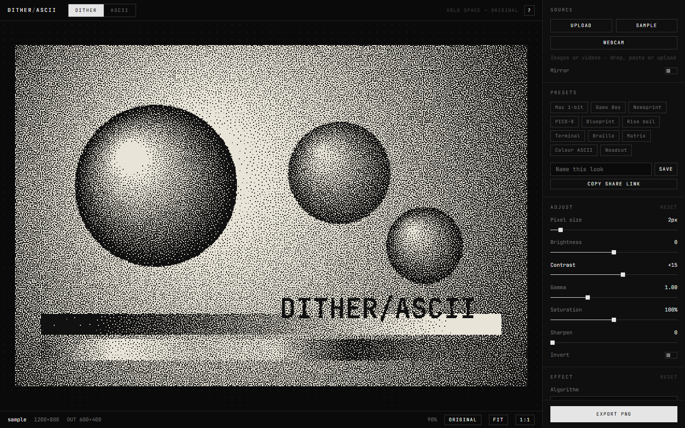

# Dither / ASCII

A browser-based generator that turns images, videos and your webcam into **dithered pixel art** and **ASCII art**, live as you adjust. Everything runs client-side on WebGL2, so there's no server and nothing to install. It is hosted on GitHub Pages.

**Try it:** https://ttawannn.github.io/dither-ascii-generator/



## Highlights

- Real-time preview of every setting, including on video and webcam
- 17 dither algorithms, from ordered Bayer and blue noise to classic error diffusion
- 8 palette options: retro systems, duotone colour picks, your own colours, or colours extracted from your image
- ASCII mode with 48 character sets, depth and offset controls, palette colours and transparent backgrounds
- A "boil" animation that brings still images to life
- Export to PNG, SVG, GIF, WebM or MP4, or copy the ASCII as text; print sizes and whole folders of images in one go
- Presets you can save and share as a link

Your files never leave your device. All processing happens in the browser.

**Works offline:** after the first visit the app (fonts included) is cached, so it opens without a connection, and it can be installed as an app from the browser menu. A new version is picked up the next time it is opened online.

## How to use

1. **Load a source.** Drag an image or video onto the page, paste an image with `Ctrl+V`, click **Upload**, or start the **Webcam**. **Sample** loads a built-in test image.
2. **Pick a mode.** Use the **Dither** or **ASCII** tabs at the top, or press `D` / `A`.
3. **Tune it.** Use **Adjust** for brightness, contrast, gamma, a shadows / midtones / highlights tone curve, saturation, hue, sharpen, blur, denoise and invert, then **Effect** for the mode-specific settings. Hold `Space` (or the **Original** button) to compare with the source, or press **Split** (`S`) to see the original and the result side by side with a draggable line. Undo and redo any change with the ↶ ↷ buttons or `Ctrl+Z` / `Ctrl+Shift+Z`.
4. **Export.** Choose a format in the **Export** section and press **Export**.

New to it? Start from one of the **Presets** (Mac 1-bit, Game Boy, Newsprint, Terminal, Braille, Matrix…) and tweak from there.

## Dither mode

| Group | Algorithms | Extra controls |
|---|---|---|
| Ordered | Bayer 2×2, 4×4, 8×8, blue noise | Strength |
| Pattern | Halftone dot, halftone line, crosshatch, honeycomb | Strength, cell size, angle, follow image (the pattern bends along the picture's shapes); rings for honeycomb |
| Pattern | Orbs: soft circles smeared into streaks over a Bayer pattern, drifting with Boil | Strength, orb size, count, intensity, size variation, vertical |
| Pattern | Halftone CMYK: four ink screens printed over white (ignores the palette) | Cell size, angle per ink, dot gain, black replacement, smoothing |
| Error diffusion | Floyd–Steinberg, Atkinson, Jarvis–Judice–Ninke, Stucki, Burkes, Sierra, Sierra two-row, Sierra Lite | Diffusion amount, serpentine scan, wave (lines through the threshold, with wavelength, tilt, and follow image to bend them along the picture's shapes) |
| Other | Random noise, threshold | Strength / threshold |

**Palettes:**
- Mono / Duotone: any two colours, 2–16 levels, with quick colour presets
- Retro systems: Game Boy, CGA, PICO-8, Commodore 64
- Custom: 2–32 colours you pick, paste as hex, or import from a palette file (JSON, .hex, GIMP .gpl), matched by nearest colour or by brightness
- Palette library: import many palette files at once, or a `.zip` of them, and pick from a searchable list; you can also save the current custom palette to it. The library is kept in this browser.
- **Perceptual match** (for palettes picked by nearest colour): compares colours in OKLab, so lightness is kept closer to the original
- RGB levels: per-channel colour steps
- From image: median-cut extraction of 2–16 colours

**Pixel size** (1–16) sets how chunky the result is.

Ordered and pattern dithers run on the GPU. Error diffusion runs in a Web Worker, so the UI stays responsive.

## ASCII mode

- **48 character sets in 11 groups:**
  - Classic ASCII, numbers, symbols, blocks, lines & boxes, braille, geometric shapes
  - Languages: Katakana, Greek, Cyrillic, Runic, Hebrew
  - Cards & games, assorted Unicode, and your own custom ramp

  Every set is measured and sorted from sparse to dense automatically. A live preview shows the characters in use.
- **Depth:** how many brightness levels to use, from 2 up to every glyph in the set
- **Offset:** shifts which character each brightness gets, wrapping around the set
- **Add characters:** mix up to 10 of your own into any set. **Include space** controls the blank glyph.
- **Edge glyphs:** draws `- / | \` along edges for a hand-drawn look
- **Dither:** ordered dither applied before choosing characters
- **Layout:** column count, font (JetBrains Mono, IBM Plex Mono, VT323, Courier, or your own: **Add font…** takes a .ttf, .otf, .woff or .woff2 file and keeps it in this browser), bold, font size and line height. A look that names a font you added is shared by name; where that font isn't added, a fallback is used and you are told so.
- **Animate:** LFOs (sine, triangle, saw) on Offset and Depth, with speed and amount controls
- **Colour:**
  - Mono, with text and background colours and a swap button
  - Image colour per character
  - Palette colours (PICO-8, C64, CGA, Game Boy, your custom palette, or 8 colours taken from the image)
  - Image colour as the cell background
  - **Transparent background**, kept in PNG, GIF and WebM exports

Copy the result to the clipboard, or save it as `.txt` or as a standalone coloured `.html` page.

## Video, webcam and animation

- **Video files:** play/pause (`K`), scrub, loop and sound in the bottom bar. Every frame is processed live. **In** / **Out** (`[` / `]`) trim the clip: playback stays inside the marks and exports render only that range; **×** clears them.
- **Webcam:** a live feed with a **Mirror** toggle (on by default for the camera). The browser asks for camera permission first.
- **Boil:** turn it on under **Animation** to make the dither pattern or ASCII characters shift over time (1–30 fps), even on a still image. For error diffusion and ASCII you can pick the jitter pattern (random or blue noise, which is more even) and its amount.
- **Animate settings:** pick almost any slider and press **+ Animate**. Each lane is either an **LFO** (shape, speed, swing around the slider value) or **Keys**, going from one value to another with easing and repeat / ping-pong / once looping over a timeline of 1–30 s. A third kind, **Audio**, follows the loudness of the bass, mids or highs (strength, smoothing) of a **Microphone** (live) or an **Audio file** chosen under Audio input. An audio file is analysed up front, so exports move exactly with the music and WebM / MP4 exports include it as the soundtrack. Up to 8 lanes run at once, and still images with lanes export as GIF or video.

## Layer 2

Turn on **Layer 2** to render the same picture a second time, in Dither or ASCII mode with its own algorithm, palette, characters and pixel size, and blend it over the first (normal, multiply, screen, overlay, difference) with an opacity. Adjust, effects, the mask and animation are shared. The effects run once on the combined image. With **Mask this layer only**, the Mask decides where layer 2 shows instead of limiting the whole result. Layer 2 is part of presets, share links and undo.

## Mask

Limit the result to part of the picture. **Mask by** a brightness range (from / to) or a colour range (hue ± width), measured on the original image, with feather and invert. Outside the mask you can show the original, a flat colour, or transparency (kept in PNG, GIF and WebM exports). **Show mask** previews it in black and white. The mask applies after the effects, and its sliders can be animated.

## Effects

Stack post-effects on top of either mode. Turn each one on or off, and use ↑ ↓ to change the order they're applied in:

- **Glow:** bright areas bloom, up to 200 px wide (radius, intensity, threshold, softness, stretch, angle, falloff)
- **JPEG glitch:** an overall amount and block size, plus a share for each kind: block shift, colour crush, channel swap, scanline offset, block scramble, interlace
- **Chromatic aberration:** red, green and blue each pushed outwards or inwards by their own share of the max shift
- **Scanlines / CRT:** dark lines, with optional screen curvature
- **Vignette:** darkened corners
- **Film grain:** noise in 1–4 px cells
- **Tint:** a colour blended over the image (multiply, screen, overlay, soft light, colour, colour burn) with opacity
- **Finish:** soften, sharpen and hue-shift the final image

Glitch and grain move when **Boil** is on. Effects are included in every export, in presets and in share links.

## Export

| Format | What you get |
|---|---|
| PNG | The current frame, scaled 1–8× with crisp pixels |
| SVG | A vector version of low-colour dither output (up to 32 colours). With **Vector dots**, Halftone dot (2-colour palette) and Halftone CMYK become real circles, one per screen cell, ready for print |
| GIF | An animation from a video, the webcam, or a still image with Boil or an ASCII LFO on |
| WebM / MP4 | The same as GIF, encoded as video (needs WebCodecs, see below). WebM keeps a transparent background; MP4 fills it with the background colour |
| Copy / .txt / .html | ASCII mode only: the characters as text |

For animated formats, set the **duration** (up to 30 s) and **frame rate** (5–30 fps). Video files export from the current playhead (or the trimmed In–Out range), one frame at a time, so the result is smooth even when live preview is slow. Press the button again to cancel.

**Print size:** turn it on for PNG / SVG, pick a resolution (72–1200 dpi) and centimetres or inches. The export summary shows the printed size, PNG files carry the resolution so layout and print programs open them at that size, and SVG files get physical width and height.

**Batch…** (PNG / SVG): choose several images and each one is rendered with the current look and saved, all together in one `.zip`. The image on screen stays as it was.

## Presets and sharing

- Click a built-in preset to apply a complete look.
- Type a name and press **Save** to keep your own presets in this browser.
- **Copy share link** puts your current settings into the URL (`#s=…`). Anyone opening the link gets the same look.
- **Export look** downloads the current settings as a `.json` file (named from the box above), and **Export saved** puts every saved preset in one file, so looks can move between browsers or computers.
- **Import preset…** (or drop a `.preset` / `.json` file on the page) applies a preset file and keeps it under Saved. A file of several presets is added to Saved without changing the current look. Besides this app's own files it reads preset JSON from other tools that describe a palette, a dither style and a list of effects: values are mapped onto the closest settings here, and a short report lists what was approximated and what has no equivalent.

## Keyboard shortcuts

| Key | Action |
|---|---|
| Hold `Space` | Show original |
| `S` | Split view: original \| result |
| `Ctrl+Z` / `Ctrl+Shift+Z` | Undo / redo |
| `F` / double-click preview | Fit to view |
| `1` | 100% zoom |
| Wheel / drag | Zoom / pan |
| `D` / `A` | Dither / ASCII mode |
| `K` | Play / pause video |
| `[` / `]` | Trim video: In / Out |
| `B` | Toggle boil |
| `T` | Dark / parchment theme |
| `O` | Open file |
| `E` | Export |
| `?` | Show all shortcuts |
| Double-click a slider | Reset that value |
| `Ctrl+V` | Paste image |

## Browser support

Any current browser with **WebGL2** (Chrome, Edge, Firefox, Safari). WebM / MP4 export uses **WebCodecs**: Chrome, Edge, Safari 16.4+ and Firefox 130+. GIF export works everywhere.

## Development

Built with [Vite](https://vitejs.dev/) and TypeScript, no UI framework. GIF encoding uses [gifenc](https://github.com/mattdesl/gifenc). WebM / MP4 muxing uses [Mediabunny](https://mediabunny.dev/).

```bash
npm install
npm run dev        # http://localhost:5173
npm run build      # type-check + production build into dist/
```

Open `/?sample` to start with the built-in test image.

```
src/
  main.ts       app wiring, render loop, export flow
  state.ts      settings store and validation
  presets.ts    built-in / saved presets and share links
  preset-import.ts  reads preset files (own format and external JSON)
  pipeline/     WebGL2 renderer, shaders, palettes, error-diffusion worker
  ascii/        character sets, glyph atlas, character grid
  source/       image, video and webcam sources
  export/       PNG, SVG, GIF, WebM / MP4
  ui/           controls, preview zoom/pan, video transport bar
```

### Deploy your own copy to GitHub Pages

1. Fork or push this repo to GitHub as `dither-ascii-generator`. The name is used as the base path in `vite.config.ts`, so change it there if you rename the repo.
2. In the repo, go to **Settings → Pages → Source: GitHub Actions**.
3. Every push to `main` builds and deploys via `.github/workflows/deploy.yml`.
